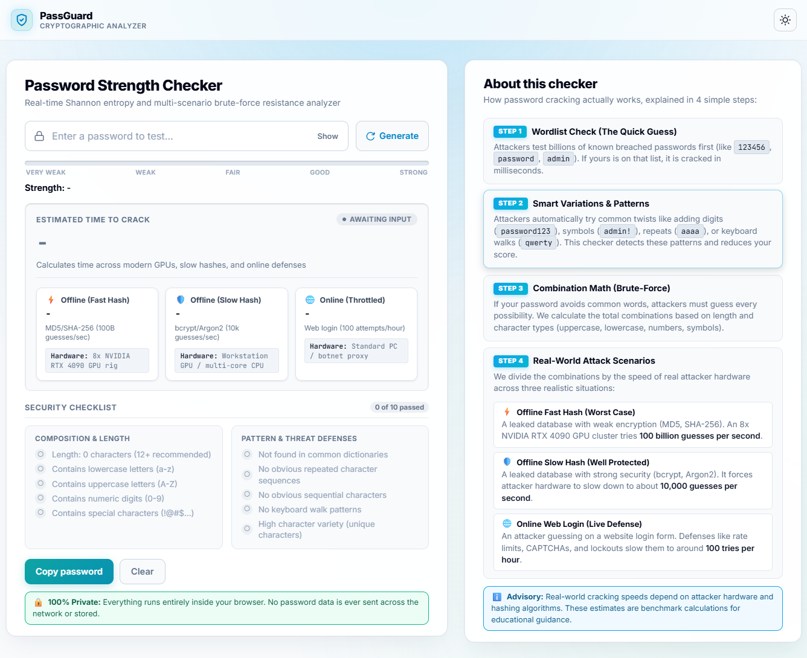

<div align="center">

# PassGuard: Real-Time Password Strength & Entropy Analyzer

**A modern, zero-dependency client-side cryptographic analyzer that estimates Shannon entropy, detects heuristic patterns, and models real-world GPU cracking speeds across practical threat scenarios.**

[](https://passguard.multihat.dev/)
[](https://github.com/SagarBiswas-MultiHAT/Password-Strength-Checker/stargazers)
[](https://github.com/SagarBiswas-MultiHAT/Password-Strength-Checker/blob/main/LICENSE)
[](#)
[](#)
[](#)

<br />

[Explore Live Demo](https://passguard.multihat.dev/) | [Key Features](#-key-features) | [Cracking Model](#-how-password-cracking-works-4-stage-model) | [Benchmarks](#-attack-scenarios--hardware-benchmarks) | [Quick Start](#-quick-start--local-development)

<br />

<a href="https://passguard.multihat.dev/">
  
</a>

</div>

---

## Overview

Most online password meters rely on basic regex counters (such as "must contain 8 characters and 1 symbol") which fail to reflect how modern password-cracking engines (like Hashcat and John the Ripper) operate. 

**PassGuard** is an open-source, cybersecurity-grade password strength analyzer built with vanilla JavaScript, modern CSS, and semantic HTML5. It computes mathematical **Shannon entropy**, applies rigorous penalty deductions for human patterns (monotonic sequences, repeated chunks, spatial keyboard walks, and dictionary stems), and translates brute-force search space into **concrete cracking times across three real-world threat levels**.

Everything runs 100% locally inside the client browser. No telemetry, no backend dependencies, and zero network calls.

---

## Key Features

* **Shannon Entropy Engine:** Accurately estimates search space based on active character sets ($26$ lowercase, $26$ uppercase, $10$ digits, $33$ symbols) and string length, with logarithmic overflow protection.
* **Realistic Attack Modeling:** Calculates crack times across three real-world attacker setups:
  * **Offline Fast Hash:** 100 billion guesses/sec (8x NVIDIA RTX 4090 GPU cluster targeting MD5 or SHA-256).
  * **Offline Slow Hash:** 10,000 guesses/sec (workstation targeting hardened bcrypt or Argon2id).
  * **Online Throttled:** 100 attempts/hour (rate-limited login endpoint with CAPTCHA defenses).
* **Heuristic Pattern Penalties:** Catches non-random human choices:
  * Monotonic alphabetical and numerical walks (`12345`, `fedcb`).
  * Back-to-back repeated sequence chunks (`abab`, `1212`).
  * Spatial keyboard walks on standard QWERTY layouts (`qwerty`, `asdf`, `!@#$%`).
  * Common dictionary passwords and modified prefix/suffix variations (`password123`, `!admin!`).
* **Cryptographically Secure Generator (CSPRNG):** Built-in 16-character password generator using `window.crypto.getRandomValues()`, rejection sampling to eliminate modulo bias, and unbiased Fisher-Yates shuffling.
* **10-Point Security Checklist:** Interactive checklist categorized into *Composition & Length* and *Pattern Defenses*, providing real-time visual statuses (Pass, Fail, Warning, Neutral Pending).
* **Context-Aware Actionable Advice:** Generates personalized recommendations based on exact weaknesses found in the entered password.
* **Modern Cybersecurity Aesthetic:** Sleek glassmorphic cards, responsive multi-scenario grid, subtle ambient glows, and a zero-FOUT dark/light theme switch.
* **Accessible & Screen-Reader Ready:** Built with semantic HTML5, explicit ARIA live regions (`aria-live="polite"`), and clear keyboard navigation support.

---

## How Password Cracking Works (4-Stage Model)

Modern brute-force tools do not guess purely at random. PassGuard evaluates passwords through a 4-stage pipeline that models modern adversarial workflows:

```
[ Input Password ]
        |
        v
[ Stage 1: Dictionary Lookup ] ----> Known breach match? Instant crack (0 entropy)
        |
        v
[ Stage 2: Heuristic Pattern Checks ] -> Deduct penalties for walks, repeats, stems
        |
        v
[ Stage 3: Entropy-Penalized Search Space ] -> Calculate log2 combinations & effective bits
        |
        v
[ Stage 4: Attack Speed Division ] -> Map search space against 3 physical attacker setups
```

### Stage 1: Dictionary Attack Check (The Quick Guess)
Automated tools check leaked wordlists containing billions of exposed passwords (such as `123456`, `password`, `admin`). If a match is found, the password is broken in milliseconds regardless of length.

### Stage 2: Rule-Based Mutations & Patterns
Attackers run automated rule sets to mutate dictionary words by appending numbers (`password123`), wrapping symbols (`!admin!`), repeating letters (`aaaa`), or following keyboard layouts (`qwerty`). PassGuard detects these mutations and applies mathematical score penalties.

### Stage 3: Entropy-Penalized Combinatorics
If the password avoids common dictionary roots, an attacker must conduct an exhaustive search across the remaining combinatorial space. PassGuard calculates raw Shannon entropy:

$$H = L \times \log_2(N)$$

Where $L$ is password length and $N$ is the character pool size. Penalties for low diversity, repetitive patterns, and sequential runs are subtracted from $H$ to yield the **Adjusted Entropy**.

### Stage 4: Dividing Guesses by Attack Speed
The total guess space ($2^{H-1}$ average attempts) is divided by real-world cracking hardware throughput across three defense scenarios.

---

## Attack Scenarios & Hardware Benchmarks

| Threat Scenario | Guess Rate | Target Hash / Defense | Representative Hardware Rig | Real-World Context |
| :--- | :---: | :--- | :--- | :--- |
| **Offline (Fast Hash)** | **$10^{11}$/sec** (100 Billion) | Fast unsalted hashes: MD5, NTLM, raw SHA-1, raw SHA-256 | Dedicated 8x NVIDIA RTX 4090 GPU cluster running Hashcat (~3.6 kW under load) | Worst-case leak scenario where a database with weak or unsalted hashes is breached. |
| **Offline (Slow Hash)** | **$10^{4}$/sec** (10,000) | Hardened memory-hard KDFs: bcrypt (cost 12+), Argon2id, PBKDF2 | Modern high-thread workstation GPU or multi-core CPU (e.g., RTX 4090 / Threadripper) | Standard security standard where database hashes are properly salted and compute-hardened. |
| **Online (Throttled)** | **~0.0278/sec** (100 / hour) | Defended public authentication endpoint | Standard desktop PC or distributed residential proxy botnet | Attacker attempting live credentials against a login portal protected by rate limits and lockouts. |

---

## Comparison: Why PassGuard?

| Feature | Basic Form Checkers | Heavy Libraries (e.g. zxcvbn) | PassGuard |
| :--- | :---: | :---: | :---: |
| **Zero Dependencies** | Yes | No (Large bundle size, 400KB+) | **Yes (0 external packages)** |
| **Download Footprint** | Small | Large | **Ultra-lightweight (< 30 KB)** |
| **CSPRNG Password Generator** | No | No | **Yes (`crypto.getRandomValues`)** |
| **Real-World GPU Hardware Models** | No | Rough single estimate | **Yes (3 distinct threat scenarios)** |
| **Pattern Walk & Run Detection** | Basic regex | Dictionary matching | **Yes (Monotonic runs + QWERTY paths)** |
| **Dynamic Checklist UI** | Static | None (Score only) | **Yes (10-point categorized checklist)** |
| **Accessible ARIA Live Regions** | Rare | None | **Yes (Full WCAG compliant live regions)** |
| **Dual Theme System** | Rare | None | **Yes (Zero-FOUT Dark & Light modes)** |

---

## Project Structure

PassGuard is intentionally structured with pure web standards for seamless portability and zero build steps:

```
Password-Strength-Checker/
├── index.html       # Semantic HTML5 markup, head theme bootstrap, and ARIA live regions
├── styles.css       # Glassmorphic cybersecurity styling, design tokens, and animations
├── script.js        # Cryptographic algorithms, entropy math, CSPRNG, and DOM handlers
├── LICENSE          # MIT License
└── README.md        # Documentation and technical guide
```

* [index.html](file:///o:/github/Password-Strength-Checker/index.html): Clean, accessible structure with inline theme initialization to eliminate Flash of Unstyled Theme (FOUT).
* [styles.css](file:///o:/github/Password-Strength-Checker/styles.css): CSS variables for dark and light modes, responsive scenario grids, and custom styling.
* [script.js](file:///o:/github/Password-Strength-Checker/script.js): High-precision logarithmic duration math, Fisher-Yates array shuffling, and real-time DOM management.

---

## Quick Start & Local Development

No Node.js build process, bundlers, or package installations are required.

### Method 1: Direct Browser Launch
Simply clone the repository and open `index.html` in any modern browser:

```bash
git clone https://github.com/SagarBiswas-MultiHAT/Password-Strength-Checker.git
cd Password-Strength-Checker
start index.html   # Windows
# or open index.html on macOS / xdg-open index.html on Linux
```

### Method 2: Local HTTP Server

Using Node.js:
```bash
npx serve .
# Application will run on http://localhost:3000
```

Using Python:
```bash
python -m http.server 8000
# Application will run on http://localhost:8000
```

---

## Integration in Other Projects

You can easily embed PassGuard into your existing registration, profile settings, or authentication flows.

### 1. Extract Core Analysis Logic
The `analyzePassword(password)` function in [script.js](file:///o:/github/Password-Strength-Checker/script.js) is self-contained. It takes a raw string and returns a complete analysis object:

```javascript
import { analyzePassword } from './script.js';

const result = analyzePassword("MySecureP@ssphrase2026!");

console.log(result.score);            // Qualitative score from 0 to 5
console.log(result.adjustedEntropy);  // Shannon entropy in bits
console.log(result.crackTimes);       // Estimated crack time strings for all 3 scenarios
console.log(result.suggestions);      // Tailored improvement recommendations
```

### 2. Standalone Embed
Include `index.html` as an iframe or integrate the component markup directly into your design system or dashboard.

---

## Security & Privacy Guarantee

* **100% Client-Side:** All string operations, regex parsing, and cryptographic calculations happen inside the user's browser memory.
* **Zero Remote Network Calls:** PassGuard does not transmit credentials, hashes, or keystrokes to any third-party server or API.
* **Defensive Constraints:** Input values are bounded (`maxlength="128"`) to protect browser threads against denial-of-service memory exhaustion attacks.
* **Advisory Purpose:** Entropy calculations are mathematical estimates intended for user education and client-side feedback. Production backends should always enforce server-side validation and store credentials using salted, memory-hard hashes (Argon2id or bcrypt).

---

## Contributing

Contributions, feature requests, and bug reports are welcome.

1. Fork the repository.
2. Create your feature branch (`git checkout -b feature/AmazingFeature`).
3. Commit your changes (`git commit -m 'Add some AmazingFeature'`).
4. Push to the branch (`git push origin feature/AmazingFeature`).
5. Open a Pull Request.

If you find this project useful, please consider giving it a **Star** on GitHub to help others discover it.

---

## License

Distributed under the **MIT License**. See [LICENSE](file:///o:/github/Password-Strength-Checker/LICENSE) for full details.

Developed with precision by [Sagar Biswas](https://github.com/SagarBiswas-MultiHAT).
